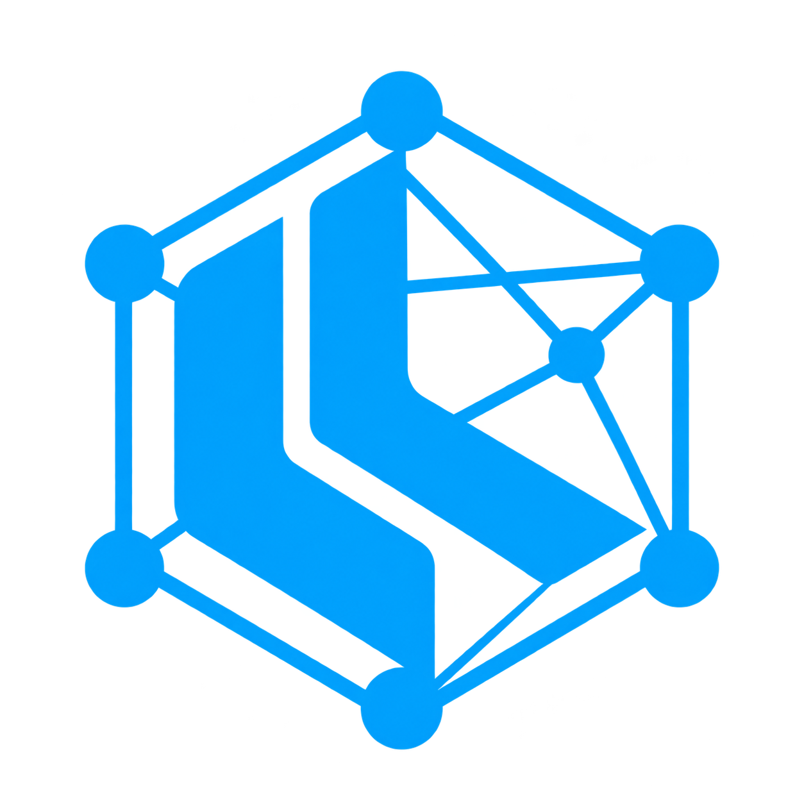

<p align="center"></p>
<h1 align="center">LLMesh</h1>
<p align="center"><strong>Your hardware. Your intelligence. Your rules.</strong></p>
<p align="center">Local AI. Shared compute. A network people can own.</p>
<p align="center">
  <a href="LICENSE"></a>
  <a href="package.json"></a>
  <a href="rust/README.md"></a>
</p>

LLMesh turns your computer into an AI node. It detects your hardware, chooses a Qwen model, prepares it locally, and gives your applications an OpenAI-compatible endpoint. Connect trusted peers and requests can use a suitable available worker, with streamed responses and metered credits: one credit for each reported input or output model token.

You choose how much computing power to contribute. Use the machine in front of you, share a home GPU with your other devices, or build a trusted group that pools access to larger models.

**Current status:** an Electron/Node implementation with local inference, a trusted peer mesh, prototype Base token contracts and a Rust/WASM foundation. No live LLMESH token or escrow deployment is supplied. The web worker and desktop-approved QR device linking are implemented. Native Android, full Nostr remote signing, the full Rust daemon and the downloadable installer matrix remain roadmap work.

[Open the web worker](https://amosroger91.github.io/LLMesh/) · [Start](#start-running) · [Features](#what-works-today) · [API](#one-endpoint-for-your-tools) · [Vision](#what-happens-when-the-network-grows) · [Roadmap](#where-were-going)

## Why LLMesh exists

Useful AI should not require surrendering every conversation to a remote platform. It should not disappear because a provider changes its prices, closes an account, or decides a community is no longer worth serving.

LLMesh starts with a practical alternative: run an open-weight model on hardware you control. Then extend that control to a network you choose. Keep familiar tools, connect through a standard API, and make the underlying compute replaceable.

The ambition is to put more of AI's infrastructure in the hands of the people who use it: individuals, classrooms, cooperatives, research groups and small businesses. Ownership should include the ability to inspect the software, choose the machines, set participation rules, and leave with your identity and data.

## What works today

| Feature | What it does |
| --- | --- |
| Hardware-aware setup | Detects CPU, RAM and GPUs; selects from the checked-in Qwen catalog and prepares a model with Ollama |
| Contribution levels | Low, Medium or High; Medium is the default, and the app chooses the model |
| Multi-GPU planner and pool | Plans independent instances or same-backend GPU splits, manages isolated runtimes and advertises slots |
| Streaming mesh inference | Authenticated, Noise-encrypted Hyperswarm connections between trusted nodes |
| Complexity-aware routing | Recommends a tier, then weighs availability, latency, throughput and price |
| OpenAI-compatible API | Model discovery, streamed chat, function tool calls, route previews and receipts |
| AI companion | A chat interface to that same mesh pipeline, with cancellation and local history |
| Network map | Live graph of known trusted desktops, their linked browser devices and your donated API workers |
| Web worker | One-button Qwen3.5 WebGPU/WASM setup, online count and request activity; no wallet UI |
| QR device linking | Desktop-signed, expiring, one-use worker pairing with desktop approval and immediate revocation |
| Donated API capacity | OpenRouter :free, Groq or another OpenAI-compatible model; usage tracking, local limits and explicit consumer consent |
| Swarm requests | Bounded task fan-out across available slots, with ordered results and per-task streaming |
| Dashboard | Hardware, model/setup state, online nodes including yourself, activity, endpoint details, wallet and energy estimates |
| One-click endpoint test | Sends a built-in message and shows success when a response arrives |
| Local self-service | Reserves and returns credits to the same account; no Base transaction required |
| Base integration | ERC-20 grants, funded request escrow, worker payouts and durable settlement retries when configured |
| Electricity tracking | Editable tariff/currency, NVIDIA board-power readings or fallback watts, session history and cost estimates |
| Rust/WASM foundation | Portable quote and placement code, shared Node/Rust fixtures, pinned workspace and browser WASM exports |

The multi-GPU pool is tested using simulated hardware and fake Ollama processes. Physical multi-GPU, cross-network NAT and the full platform/release matrix still need deployment testing. See [implementation status](REVIEW_STATUS.md) and [Rust parity](docs/rust-parity.md).

## Start running

Install **Node.js 24** and [Ollama](https://ollama.com/download), then:

```powershell
git clone https://github.com/amosroger91/LLMesh.git
cd LLMesh
npm ci
npm start
```

Managed runtime instances target **Ollama 0.40.2**. An existing Ollama service on port 11434 is reused in external mode by default; LLMesh does not take ownership of that process. See [runtime compatibility](docs/ollama-compat.md).

Start with **Medium**, wait for setup to show ready, then use the companion or press the endpoint test button. You can be the only online node. Local requests work without a cryptocurrency deployment.

| Level | Selection policy | CPU thread budget |
| --- | --- | --- |
| Low | Lightweight model; 35% of available model-memory budget | 25% of physical cores |
| Medium | Balanced model; 75% of available model-memory budget | 50% of physical cores |
| High | Largest estimated fit within the placement budget | All physical cores |

These are selection budgets, not electrical-power or GPU-utilization caps. Display-memory and runtime reserves reduce GPU budgets. Actual model loading can still fail; setup tries smaller candidates. CPU Low/Medium models are capped at 2B/4B. Labels never determine the price of a request.

### Models and multiple GPUs

The [catalog](models/catalog.json) supplies these choices:

| Model | Approximate download | Catalog memory estimate |
| --- | ---: | ---: |
| Qwen3.5 0.8B | 1.3 GB | 2 GB |
| Qwen3.5 2B | 3.1 GB | 5 GB |
| Qwen3.5 4B | 4 GB | 6 GB |
| Qwen3.5 9B | 7.6 GB | 10 GB |
| Qwen3.8 27B | 18 GB | 22 GB |

These are estimates, not measured guarantees. The planner permits attempts at 80% of the catalog estimate before additional runtime and contribution reserves. Longer contexts need more memory. Tags remain upstream-controlled; fully digest-pinned network catalogs are roadmap work.

In `auto` placement, **the largest model comes first**. Compatible GPUs are grouped when that enables a larger model, using the smallest sufficient set; remaining GPUs receive individual instances. Replication is preferred when it preserves the largest model, or when explicitly selected. CUDA, ROCm and Vulkan groups do not mix. Splitting is within one computer, not across peers. The pinned Ollama architecture implementation limits Qwen3.5 instances to one concurrent slot.

### Offline weights

Installed models are reused before contacting a registry. An available offline bundle is SHA-256 checked and imported before attempting a network pull.

```powershell
npm run models:bundle
npm run pack
```

Current packaging copies `models/ollama/` into the app's resource directory. The development bundle is approximately 1.23 GiB of cached Qwen3.5 0.8B assets. **A Git clone does not include the weights.** They exceed normal GitHub file limits and are ignored by Git. Create a bundle from your Ollama cache or supply it alongside the checkout. Ollama must still be installed, and both processes must agree on `OLLAMA_MODELS`. Larger selected models may need a network download.

## One endpoint for your tools

Copy these values from the dashboard into an OpenAI-compatible client:

| Client field | Value |
| --- | --- |
| Base URL | `http://127.0.0.1:7337/v1` |
| API key | Your local key, using **Copy key** |
| Model ID | `llmesh-auto` |
| Display name | `LLMesh Auto` |

```python
from openai import OpenAI

client = OpenAI(
    base_url="http://127.0.0.1:7337/v1",
    api_key="<copy your local key>",
)
response = client.chat.completions.create(
    model="llmesh-auto",
    messages=[{"role": "user", "content": "Explain how a mesh network works."}],
    stream=True,
)
for chunk in response:
    if chunk.choices:
        print(chunk.choices[0].delta.content or "", end="", flush=True)
```

| Route | Purpose |
| --- | --- |
| `GET /health` | Process health |
| `GET /ready` | Ready to accept inference, or 503 while unavailable/draining |
| `GET /openapi.json` | OpenAPI document |
| `GET /v1/models` | Automatic route and available model IDs |
| `POST /v1/routes/preview` | Complexity, candidate model, worker and price without dispatch |
| `POST /v1/chat/completions` | JSON or streamed SSE completion, including function tool calls |
| `GET /v1/receipts/:id` | Authenticated payer's receipt and settlement state |
| `POST /v1/swarm/completions` | Up to 32 independent agent tasks, bounded by available slots and a concurrency limit of 16 |
| `POST /v1/accounts` | Registration / configured relayed starter grant |
| `GET /v1/account` | Local account or linked wallet state |

Supports text and text-part arrays, developer messages, assistant tool calls and tool results. Tools execute in the requesting application. Limits: 256 messages, 128 function definitions, 90,000 serialized input characters and a 512 KiB HTTP body. Positive output limits above 2048 are accepted and clamped; receipts show requested and effective limits. Context scales from 4096 to 32768 tokens. Images, audio, embeddings and complete OpenAI API parity are not implemented.

The default API is loopback-only and rejects browser-origin calls. Protect its bearer key: configured remote requests can spend the node's tokens and gas. NIP-98 authentication also supports exact URL/method/payload binding and replay protection. The web worker uses a paired, application-encrypted WebRTC data channel to its desktop; it never receives the API bearer key and needs no wildcard CORS.

## How requests find a worker

`llmesh-auto` estimates complexity locally, avoiding an extra classifier-model call. Short tasks target a small model; programming and analysis target 4B+; multi-step system design and formal reasoning can recommend 27B.

This is a keyword/context heuristic, not proof of task difficulty. By default, a mesh without the recommended tier uses its best eligible model and marks the result `degraded`. Set `allow_degraded: false` for a strict tier. No available eligible worker still produces an error.

Routing considers trusted, fresh, idle model slots and compatible payment configuration. Local and remote hardware compete in the same pool. Scores combine RTT, first-token latency and 15% of estimated generation time. A 100 ms penalty per excess capability rank avoids tying up oversized local models on tiny tasks, while large speed differences can still win. There is no unconditional local or remote preference.

When explicitly allowed, donated API slots receive a 150 ms preference and no oversized-model penalty. Their initial unmeasured estimate is 250 ms to first token and 100 tokens/second; observations replace it. Provider capability is a model-size/name proxy, not an audited quality score. Every model still bills the same one-credit token rate: smaller devices are not secretly charged a different tariff.

A request served elsewhere does not mark your local runtime busy. Your unused slots can serve the mesh concurrently. If local hardware is already serving somebody else, that job finishes; your next request can use another eligible slot or wait. Hardware slots are reserved before funding, and queued requests have a cancellation/deadline. Swarm requests run independent supplied tasks across the available capacity; they do not invent arbitrary autonomous sub-agents or exceed slot limits.

Streams reuse connections and forward incremental output with bounded buffers, backpressure and cancellation. Funding confirmation still adds startup latency; settlement retries happen after delivery. No lowest-latency benchmark is claimed.

## Build a trusted mesh

Exchange Nostr public keys with the operators of the other nodes. Configure a shared random group secret and trust the appropriate identities:

```powershell
$env:LLMESH_TOPIC = '<shared-random-group-secret>'
$env:LLMESH_WORKERS = '<trusted-worker-nostr-public-key>'
$env:LLMESH_COORDINATORS = '<trusted-coordinator-nostr-public-key>'
npm start
```

Hyperswarm provides discovery and direct Noise-encrypted streams. A minimal signed hello precedes capability exchange; unauthenticated handshakes expire after ten seconds. Without a shared topic, identities use isolated discovery topics. Busy/duplicate work receives retryable errors. Slot-aware Node advertisements negotiate with legacy Node peers; this is separate from the future Rust libp2p cutover, which requires a coordinated group upgrade.

A remote paid worker needs a receiving wallet and matching chain/escrow settings. The issuer/coordinator dispatches and settles paid jobs. Today's network distributes complete requests, not model layers across machines.

## Compute, credits and electricity

**Using your own node:** the local ledger reserves a quote and credits it back to the same account on completion, or refunds failure. The net change is zero. No blockchain or gas is needed. Electricity and hardware still have real costs.

**Using another node:** 1 credit is spent and 1 credit earned for every reported input token plus generated token. A completion with 300 input and 120 output tokens transfers **420 credits** from requester to worker, regardless of model size or contribution level. Actual tool-call generation is included in runtime token usage. An initial refundable reservation covers the configured context ceiling plus output limit; unused credits are returned at settlement. The maximum authorization is 34,816 credits. A reservation is not the final price.

New approved accounts start with **100,000 credits**. Existing local accounts receive a one-time 99,900-credit upgrade from the old 100-credit starter allocation without resetting past spending or earnings. Registration remains once per wallet and Nostr key, with allowlist admission and rate limits. Pairing a browser does not create a new account or grant. A self-served request returns the reservation to the same account: **no self-mining or net issuance**.

The [contracts](contracts/LLMesh.sol) implement an 18-decimal ERC-20: one whole LLMESH represents one inference credit. **Metered billing requires the new token and escrow v4; v3 deployments are incompatible and are not upgraded automatically.** New deployments issue the 100,000-credit grant. Existing on-chain deployments need an explicit migration/redeployment; a local database upgrade does not mint ERC-20 tokens.

Escrow locks a maximum budget, pays the attested used credits to the worker, and returns the rest to the payer in one settlement. Delivery signatures bind the actual used-credit amount as well as chain, contract, job and output hash. Workers check that the attested count matches their recorded usage before accepting it. Durable retries separate generation from confirmation. Early refunds require signed worker failure; ordinary refunds wait for expiry plus a 24-hour dispute window. Failed or cancelled generations without final usage do not earn credits; the system does not guess token counts from streamed text.

Local credits cannot pay other nodes or become ERC-20 balances. Base gas is additional. No live deployment, independent contract audit, token market value or permissionless proof of correct inference is supplied. The coordinator remains trusted for admission and delivery attestations. Payment channels, stronger distributed settlement and recovery are planned.

In **Energy & costs**, enter your electricity price per kWh and currency. NVIDIA board-power readings can be combined with estimated host overhead; other systems use editable fallback watts. A wall-meter reading can override the estimate. Local sessions and per-currency totals persist. Measurements can include other applications; CPU/PSU overhead and unsupported hardware are estimates. Concurrent-instance attribution and idle-baseline subtraction still need work. There is no automatic token-to-fiat conversion.

For contract testing without real funds:

```powershell
npm run chain
# In another terminal, use only a public development key printed by that chain:
$env:LLMESH_RPC = 'http://127.0.0.1:8545'
$env:LLMESH_DEPLOYER_KEY = '<development private key>'
$env:LLMESH_ISSUER = '<app wallet address>'
npm run contracts:deploy
```

The temporary JavaScript test chain uses chain ID 31337. Never fund its public keys with real assets. Configure peers with the same token/escrow addresses. Base Sepolia is 84532; Base mainnet is 8453. Live deployment requires explicit confirmation and a funded deployer; starting LLMesh does not deploy contracts.

## Use the web worker

Open **[amosroger91.github.io/LLMesh](https://amosroger91.github.io/LLMesh/)** on a WebGPU-capable browser. Press **Download model & start serving**. The SDK is loaded on demand; Qwen3.5 0.8B uses a browser-compatible MLC artifact (q4f16 or q4f32 depending on the adapter), not the Ollama file. About 1.6–1.9 GB of GPU memory is estimated. Downloads are cached locally. Unsupported hardware produces a visible error; a CPU-only browser fallback is not claimed.

On the desktop open **Network map → Generate pairing QR**. Scan it with the web app or phone camera, then **approve the device on the desktop**. The QR is signed by the desktop Nostr account and binds its ephemeral encryption key, worker-only scope, nonce and two-minute expiry. The one-use code contains no root secret, wallet key or API bearer key. ECDH/AES-GCM protects application traffic in addition to WebRTC transport encryption. Linked worker earnings go to the desktop receiving wallet through its normal settlement; the browser has no wallet screen or spending authority.

Keep both the desktop and worker tab open. Hidden tabs withdraw ready slots; active work finishes before pausing. A missing heartbeat withdraws a device within 30 seconds. Disconnect/reload may require scanning a fresh QR; this is a scoped worker session, not full NIP-46 root-account login. PeerJS uses public signaling; data traffic is direct where connectivity permits. Some NAT/firewall combinations need a TURN service that is not supplied here. No universal cross-network connectivity is claimed.

The graph includes your desktop, trusted peers, linked browser devices advertised by those peers, and your ready donated API workers. It shows the known mesh, not a global census. Web requests are received through the desktop bridge and share the same native mesh routing and metered accounting.

## Donate API allowance, bank inference credits

A GPU is one way to contribute. Another is to donate an API allowance you are authorized to use: **OpenRouter free models, Groq free-tier projects, or an OpenAI-compatible Chat Completions endpoint**. Open **Donate API tokens**, enter a key, discover/select a model, set a daily token cap and explicitly confirm your free-tier/spending controls. Keys are encrypted with desktop OS storage and never advertised or returned in status. No provider account is created automatically.

Donations earn one credit per actual reported input/output token when serving another account. Usage is recorded per donated configuration and reported upstream model, with request counts and daily totals. Unknown usage from failed calls consumes its maximum local allowance conservatively in a separate counter; it does not mint inference credits. Rate limits/errors temporarily withdraw the slot. There is no automatic switch to paid models.

OpenRouter donations require a `:free` model or `openrouter/free`. Groq/custom billing and provider terms cannot be verified by LLMesh: use permitted account credentials and provider-side spend limits. The local daily cap is not a guarantee of the provider's invoice. Streamed responses must report token usage; endpoints that omit it are paused rather than billed from a character estimate. See [OpenRouter free variants](https://openrouter.ai/docs/guides/routing/model-variants/free) and [Groq compatibility](https://console.groq.com/docs/openai).

**Consumer privacy is explicit and defaults to mesh only:**

```json
{"model":"llmesh-auto","privacy":"mesh-only","messages":[{"role":"user","content":"Keep this on trusted mesh workers."}]}
```

Set `"privacy":"allow-third-party"` (or `allow_third_party:true`) to permit donated APIs. The desktop has the same visible selection. Mesh-only filtering is enforced by the router and independently by the donated runtime; there is no silent API fallback. Receipts identify source, provider and offered upstream model. Donor usage records include the model actually reported by the provider. Transport encryption does not make a cloud provider private. Trusted mesh workers also see the plaintext they process; privacy still depends on the chosen operators.

## Parallel swarm requests

`POST /v1/swarm/completions` accepts `tasks` (1–32 normal chat jobs), `max_concurrency` (1–16), and optional `stream:true`. Tasks carry their own privacy choice. Agents are bounded by known slots, results keep task order, and each task gets its own route, usage and receipt. SSE progress is indexed by task. These are independent user-supplied jobs, not speculative hidden work.

## Your data, your boundaries

Companion history stays in IndexedDB. Preferences stay in localStorage; accounting and energy records use local SQLite. Desktop secrets use Electron safeStorage and stay out of renderer status responses. Headless keys support passphrase encryption with scrypt and AES-256-GCM. Without a passphrase, protect the data directory with OS access controls; Windows file mode 0600 is insufficient.

Local inference can keep prompts on your machine. Remote inference sends them to the selected worker, which must see plaintext to run today's models. Transport encryption does not hide prompts from that worker. Choose peers accordingly. This is not confidential-computing attestation or a guarantee of deletion by a remote operator.

The app contains no social rooms, public feed or RSS bots. Nostr provides identity and authentication. Worker-only QR linking and revocation are available for browser devices. Full cross-platform account sign-in through NIP-46 and independent offline recovery remain planned. Back up irreplaceable keys before funding a wallet; a complete cross-platform recovery flow remains work.

## What happens when the network grows

**Contribute overnight. Build during your workday.** A developer without a 16 GB GPU could let a smaller computer serve real requests while idle, bank the earned credits, then spend them on another person's larger model during work. Their own hardware remains in the pool: suitable tasks can stay local, tiny tasks can use waiting mobile/browser workers, and demanding tasks can use higher-end machines. Donated API allowance adds capacity for people without a useful GPU and can help bootstrap speed and model quality.

The tangible unit is reported inference work, not merely leaving an app open. Idle time does not mint tokens. ERC-20 balances are transferable, enabling a future exchange for money as well as inference; an exchange, liquidity and monetary value are not supplied or guaranteed. One token is an accounting unit accepted by participating workers, not a guaranteed claim on reserved hardware, electricity, or a fixed quality of answer. Model tokenizers and computational costs differ; the current uniform rate is an explicit initial exchange policy.

One local model gives one person more control. A widely adopted mesh could make that control useful at a different scale: a classroom sharing a GPU after hours, a neighborhood cooperative pooling hardware, an independent researcher accessing a larger model, or a small organization running its own private inference network.

Instead of every useful interaction increasing dependence on a few centralized providers, more of the capacity could belong to the people using it. Contributions could help earn access to other machines. Open interfaces would let communities change models and clients without asking a platform for permission.

That is one route toward **democratizing access to LLMs**: lower the barrier to participation, make useful capability available on ordinary hardware, and let people combine resources when one machine is not enough. It could enable community services that are free to use when someone donates the compute. It does not make electricity, equipment or bandwidth free, or guarantee that every request costs nothing.

**Data sovereignty means having a meaningful choice about where your data goes and who can act on it.** Keeping a sensitive request local, choosing a trusted worker, inspecting the software and retaining your records are concrete parts of that choice. The planned privacy levels and organization-controlled edition aim to make those boundaries enforceable and visible across more deployments.

Wider adoption would not automatically remove corporate power or create an equal network. Large hardware owners could still dominate supply; relays, wallets and software distribution can become new choke points. Open code, portable identities, transparent pricing, alternatives to mandatory hosted services and community governance all matter. The goal is to give people more ways to build and use AI on their own terms—and make centralized services an option they can leave.

## Where we're going

| Track | Current state | Next destination |
| --- | --- | --- |
| Desktop | Electron/Node app and local API | Instance controls, recovery and release delivery |
| Multi-GPU | Planner/pool and simulated tests | Physical validation, complete UI and energy attribution |
| Linux | Node headless entrypoint; expanded CLI under development | x64/arm64 tarballs, deb/rpm, systemd and containers |
| Rust | Quote/placement crates, shared fixtures, CLI preview, WASM exports | Validation/routing bindings, daemon, libp2p and parity-gated desktop sidecar |
| Android | Architecture defined | Termux requester first, then Kotlin/UniFFI native app |
| Web | GitHub Pages WebGPU/WASM worker, encrypted WebRTC link, online count and activity | Real-device/browser matrix, persistent sessions and PWA requester |
| Shared accounts | Desktop-approved browser worker sessions; earnings stay on its account | Full NIP-46 signer integration and cross-platform account portability |
| Security | Trusted peers, replay checks, encrypted transport/local key options | Rust-only group PKI, privacy sealing, audit and Sovereign edition |
| Payments | Prototype fixed-price escrow | Audited channels, recovery and stronger spending controls |

The worker QR flow approves a new device through its desktop; it does not put a private key or wallet seed in the QR. Account identity, device membership and spending permission remain separate. Signing into the same account must not mint another starter grant. History synchronization is separately consented, not an automatic upload of conversations.

Node keeps shipping until Rust passes parity. WASM shares portable logic, not the entire native daemon: browsers need different transport/storage adapters and cannot spawn Ollama or inspect free VRAM like a native app. The companion continues to use the same mesh inference pipeline.

Plans and acceptance criteria:

- [Multi-GPU, Linux CLI and releases](PLAN_MULTI_GPU_AND_RELEASES.md)
- [Rust core and Android](PLAN_RUST_AND_ANDROID.md)
- [WASM web and shared accounts](PLAN_WEB_AND_ACCOUNTS.md)
- [Security, privacy and branding](PLAN_SECURITY_AND_BRAND.md)
- [Review fixes and remaining work](REVIEW_STATUS.md)
- [Rust parity checklist](docs/rust-parity.md)

Release targets include both standard and offline Windows installers, Linux x64/arm64 packages and containers, then Android artifacts. Installer packages are **targets, not downloads promised today**; the static web app is built and deployed separately by GitHub Pages. Windows builds are currently unsigned; SmartScreen may require **More info → Run anyway** for a build you have verified. No paid signing service is configured. Free keyless checksum/container signing and application to the free SignPath Foundation program are planned.

## Build, test and contribute

```powershell
npm run check             # Syntax, contracts and Node tests
npm run build:ui          # Bundle desktop UI
npm run smoke             # Hidden Electron dashboard smoke test
npm run headless          # Current Node headless entrypoint
npm run pack              # Unsigned unpacked Electron app
npm run dist              # Installer using current local packaging config
```

The expanded CLI is under development at `src/cli/index.js`:

```powershell
node src/cli/index.js --help
node src/cli/index.js gpus --json
node src/cli/index.js doctor --offline --json
```

Check the Rust preview independently:

```powershell
cd rust
cargo test --workspace --locked
cargo clippy --workspace --all-targets --locked -- -D warnings
cargo fmt --all --check
cargo build -p llmesh-web --release --target wasm32-unknown-unknown --locked
cargo run -p llmesh -- --version
```

Node and Rust consume shared placement and pricing fixtures. Tests also cover authentication/replays, stream cancellation, model fallback, process isolation, escrow accounting, durable settlement and API tool calls. CI definitions cover Node on Windows/macOS/Linux and Rust native/WASM checks. Hosted CI results and real hardware deployment are distinct from passing local tests.

Contributions that improve compatibility, reproducible benchmarks, accessibility, recovery and clear privacy boundaries are welcome. Keep behavior documented and add evidence for the capability you change. Software is [MIT licensed](LICENSE); model weights and dependencies retain their respective licenses.

<p align="center"></p>
<p align="center"><strong>Build intelligence people can own.</strong></p>


### Browser discovery, guest contribution, and optional harvesting

The web app now discovers live browser sessions and desktop gateways through signed, ephemeral Nostr presence advertisements (`relay.damus.io` and `nos.lol`). You do not need a wallet or desktop QR to appear online. The counter includes this session, deduplicates each ephemeral identity across relays, and expires silent sessions after 60 seconds. Separate tabs count separately; this is a view of reachable public advertisements, not a verified worldwide device census. Relay outages can limit discovery.

**Download model & start serving** loads Qwen3.5 0.8B locally and automatically finds a desktop gateway. With **Harvest credits to my desktop account** off (the default), your browser donates compute without holding an account or wallet. An updated desktop must be open to bridge browser workers into the native mesh. Until one is reachable, the browser honestly shows that it is finding a gateway. Guest work is donated to the gateway account; this browser accrues no recoverable balance. Enabling harvesting reveals QR pairing: scan your own desktop, approve it there, and that desktop account receives the earnings from your linked worker. No wallet private key crosses devices. Turning harvesting off disconnects the paired session and returns to guest mode.

Public guest browsers are **external workers**, not trusted devices. They are excluded from `mesh-only` requests both by routing and the browser execution guard. Consumers must select **Allow external workers** (API: `privacy: "allow-third-party"`) to permit community browsers as well as donated provider APIs. The operators of those workers can read prompts they process, even though WebRTC traffic is encrypted. Pair only devices you trust. Public discovery shares ephemeral connection information and availability, never your root account key, API key, or prompt. Desktop public gateway discovery is active while the desktop UI is open; headless public browser discovery is not implemented.

Browser data-channel messages are fragmented below WebRTC message limits, and browser slots advertise their 4096-token context ceiling. This prevents selecting a small browser for requests needing a larger context. Real public-relay discovery was verified with two independent anonymous sessions; the live WebGPU model also loaded successfully on an NVIDIA adapter. Phone-specific inference performance and restrictive NAT traversal still depend on the device/network.


The desktop **Network map** now includes both the connected compute graph and a separate **Public discovery** graph matching the web app. Discovered sessions are not automatically trusted. Browser workers are marked **Guest donation** or **Linked harvesting** so their account mode is visible. Device totals exclude donated API endpoints. The desktop also includes QR pairing/revocation, donated API controls, hardware/contribution setup, metered credit accounting, and the mesh companion. Run `npm start` from the repository to rebuild the desktop UI before launching the current code.


OpenCode compatibility: native workers handle tool calls; current WebLLM browser workers cannot. Routing now reports tool support, context limits, and privacy exclusions directly instead of presenting every failure as insufficient complexity. Native setup failures are included in the error. On Windows, measured **free** VRAM already excludes display allocations, so placement keeps the runtime reserve without subtracting the display allocation again; the additional display reserve applies only when free VRAM is unknown. Node and Rust share this rule. Actual runtime allocation and fallback still determine whether the model can load.

Verified on the RTX 3050 desktop after that placement fix: the local OpenAI-compatible endpoint selected `qwen3.5:0.8b`, returned HTTP 200, emitted a real `ping` function call with `finish_reason: tool_calls`, and metered input/output usage. This checks actual native inference, not a mocked model response.


### Phone serving, awake mode, and saved routing

**Discovered sessions are not ready workers.** The desktop now reports connected browser devices and ready browser slots separately, and its Network map has a **Test a connected browser worker** button. This streams a built-in greeting directly from a ready browser, even if native model setup has failed. An authenticated owner-only `GET /v1/node` endpoint exposes setup, browser readiness, slots and the saved inference privacy mode without API keys.

The **Inference data routing** dropdown saves immediately to the desktop preferences. There is no Save button. Its saved default applies to desktop requests and owner API clients such as OpenCode that omit `privacy` / `allow_third_party`. Explicit request settings take precedence; another signed account and incoming worker jobs never inherit the owner's permission to use external services. New installations default to `mesh-only`. To use unpaired guest phones, select **Allow external workers**. Native memory availability does not prevent a compatible ready browser from serving; current browser workers still require a text-only request within their 4096-token context and do not support OpenCode tools.

Direct WebRTC remains the preferred browser transport. Guest browsers fall back after eight seconds to an AES-GCM encrypted, signed Nostr relay transport when a direct data channel cannot connect. Relay batches carry sequence numbers, acknowledgments, bounded queues and retries; application streaming continues over that connection. Public relay operators see connection metadata, and may rate-limit or deny traffic. This is a best-effort connectivity fallback, with more latency than a direct channel, not a dedicated TURN service. QR trust pairing still requires direct WebRTC. Pair your own phone for `mesh-only` requests; pairing and credit harvesting are separate, so a trusted phone can donate with harvesting disabled.

On phone/tablet browsers, **Keep phone alive** opens a fullscreen animated mesh visualization. Where supported, the browser plays the canvas as a local video and requests a screen wake lock. The visualization shows discovered sessions, model, connection and activity, using four frames per second. No camera, microphone or screen capture permission is needed. The button stays hidden on desktop browsers. Exiting awake mode releases the wake lock and video tracks; returning to a visible tab attempts to reacquire a released lock. This keeps a visible page awake where the browser permits it; it cannot run through screen locking, background suspension or restrictive battery-saver policies. The on-screen status reports whether a wake lock was actually granted. See the [Screen Wake Lock API](https://developer.mozilla.org/en-US/docs/Web/API/Screen_Wake_Lock_API).

Native setup status is calculated only from native runtime instances: a ready donated API or phone cannot falsely mark local installation as successful. Those auxiliary workers remain routable while native setup reports a memory failure.


Donated API HTTP 413 means the upstream rejected the request before streaming; it may reflect a payload limit or a provider/account token ceiling, not a failed model installation. LLMesh now extracts numeric token limits when reported, stores them across restarts, and excludes estimated oversized jobs from that provider. There is also an optional **Provider request token limit** when adding a donation. Known limits are shown on donor cards and enforced again at execution. Estimates include tools and the requested output; exact tokenization remains provider-specific. Smaller jobs remain eligible after 413, no inference credits are earned or spent for rejected work, and that rejection no longer consumes the daily unknown-usage reservation. Automatic owner requests retry another compatible eligible worker only for a definite 413 rejection before any content; explicit model selections and prepaid mesh jobs are not silently redirected. Other failed or unmetered requests retain conservative quota accounting. No prompts or credentials from upstream error bodies are displayed.


### Observed activity in phone awake mode

The phone visualization now gives each advertised donated provider its own amber branch under the desktop that offers it. Browser-to-desktop edges are shown only when the browser reports a gateway connection. Cyan pulses represent observed outgoing request counters; lime pulses represent observed response/chunk counters. Changes are batched with public presence updates, so these are recent reported observations, not packet timing or fabricated per-token traffic. No changes means no pulses. Counter resets establish a new baseline. Only ephemeral node/provider metadata and aggregate counters are advertised; prompts and API credentials are never included. Idle providers remain amber; busy nodes turn lime. The display is capped to the discovered view, not a globally verified traffic census.

The Qwen browser worker now has a structured JSON tool adapter. At model startup it performs a real `ping` tool self-test; only a passing engine advertises `supportsTools`. It converts tool-call history/results and validates output names before returning standard OpenAI tool calls, without executing tools on the phone. Failed self-tests keep the worker text-only. The 4096-token phone context limit still applies: a large OpenCode system prompt/tool catalog cannot be made to fit merely by enabling tools. Incomplete or malformed tool responses fail explicitly rather than pretending a tool ran.

Donor cards now have **Test provider**, which sends a built-in harmless tool request through the normal metered route. HTTP 429 has a separate rate/quota explanation, respects `Retry-After`, and is eligible for safe pre-stream automatic failover. Rejected 429 work also earns/spends no inference credits and consumes no unknown-usage token reservation. Two keys do not combine provider/account quotas into a larger single-request context. On this desktop a real Groq tool-call test succeeded while the OpenRouter free model returned HTTP 429; both keys were separately registered. Large requests still need a compatible available worker or client-side conversation compaction.

Standalone OpenCode greetings with a large attached tool catalog use a small output budget and omit unused tools while preserving every system/user message. This is limited to initial, exact greetings in automatic routing; coding requests and tool history keep their tools. The receipt records the adaptation. The actual OpenCode CLI request with ten tools (about 77 KB before normalization) was verified returning `Hello.` through LLMesh.


**AI Companion is always hardware-only.** Its dedicated desktop IPC handler forces `hardwareOnly: true`, irrespective of the saved external-provider preference. Routing excludes donated APIs; both the worker dispatch path and provider runtime independently reject hardware-only jobs. Native and compatible browser hardware remain eligible under the selected privacy/trust policy. If hardware is unavailable, Companion reports that instead of spending donated API allowance. Your own or linked hardware keeps self-service credits net-zero; another account’s hardware still requires normal payment. Ordinary API clients can request the same rule with `hardware_only: true`.


**Node profiles** are available in the desktop Network map and web app. Set a node name, public bio, profile photo and ring color; changes save automatically per device. Photos are center-cropped and re-encoded locally as 64×64 JPEG thumbnails, with an 8 KB avatar limit. Desktop profiles persist with node preferences, and web profiles persist in localStorage independently of wallet linking. Public presence distributes the profile with the ephemeral session; the normal node map and phone awake graph show the photo, selected ring and name, with a shortened bio in the fullscreen graph. Other peers can see this information. Profile input is bounded, remote image URLs/SVG avatars are rejected, and profile changes do not change account identity or grant credits.

The desktop, web and phone awake maps show connected devices accepting inference, including workers currently busy on a request, plus connected devices reporting an explicit memory block. Paused, loading and disconnected sessions are counted as visitors instead of drawn as workers. Provider branches appear only while available or processing work. Public discovery expires stale advertisements after 60 seconds; it is not a global census.

Desktop AI Companion includes **Clear chat**, which removes the displayed conversation, saved IndexedDB history and unsent draft. Finish or stop an active stream before clearing. Companion requests always use hardware; donated API allowances remain excluded even when external providers are enabled for normal API clients.

**Live node status colors:** yellow means ready to serve, green means processing a request, and red means an explicit insufficient-memory diagnostic. A separate outer status ring preserves your chosen profile ring color. Connected memory-blocked devices remain visible in red; other inactive sessions remain visitors and disconnected devices stay hidden. Desktop setup errors and browser model allocation failures supply the memory flag; generic network errors do not pretend to be memory problems. These are reported device states, not remotely verified hardware telemetry.
